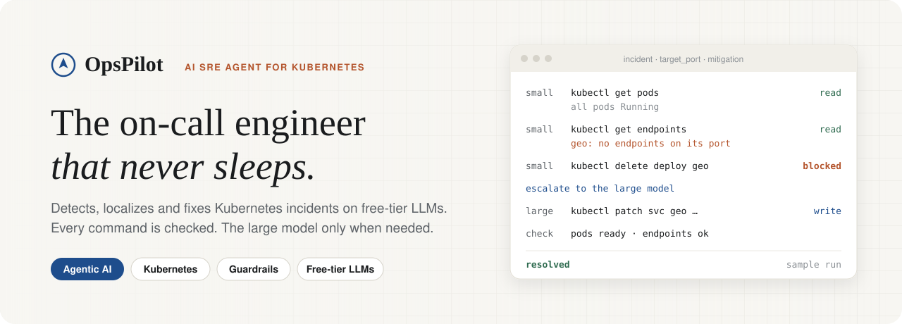
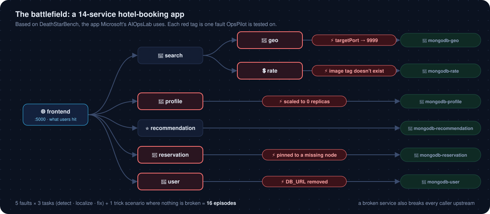
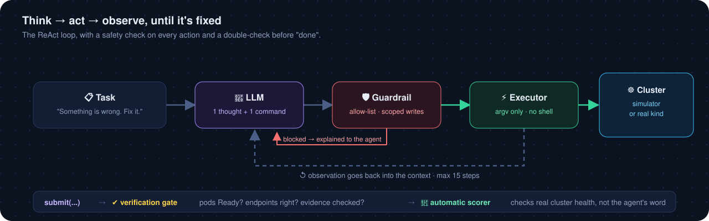
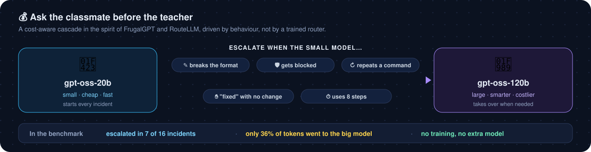
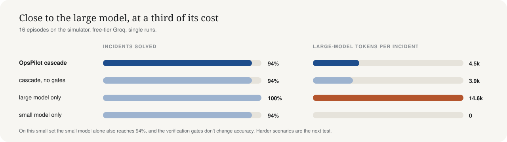

<div align="center">



<br/>

**OpsPilot** is an agentic AI that does an on-call SRE's first response on Kubernetes.<br/>
It **detects** an incident, **finds** the root-cause service and **fixes** it, while a guardrail checks every command.

<br/>


[](https://github.com/Kaushik-verse/opspilot/actions/workflows/ci.yml)


[Story](#-the-story-in-60-seconds) · [How it works](#-how-it-works) · [Safety](#-safety-first) · [Cascade](#-the-cost-trick) · [Results](#-results) · [Run it](#-run-it) · [FAQ](#-faq)

</div>

<br/>


## ✦ The story in 60 seconds

<table>
<tr>
<td width="25%" align="center"><h3>🏨</h3><b>A website is a team</b><br/><sub>A hotel-booking site is really <b>14 small programs</b> talking to each other, managed by <b>Kubernetes</b>.</sub></td>
<td width="25%" align="center"><h3>🚨</h3><b>Something breaks at 3 a.m.</b><br/><sub>A wrong port, a missing password, a bad update. Users see errors, and someone must wake up.</sub></td>
<td width="25%" align="center"><h3>🤖</h3><b>OpsPilot responds</b><br/><sub>It investigates with <code>kubectl</code>, points to the real culprit and applies a minimal fix.</sub></td>
<td width="25%" align="center"><h3>🛡️</h3><b>Safely and cheaply</b><br/><sub>A guardrail checks every command. A small free model does most of the work.</sub></td>
</tr>
</table>

> **In one line:** an LLM agent with seatbelts. It can look at and repair a cluster, but it physically cannot run anything dangerous.

## ✦ The battlefield



| | Scenario | What we break | Everyday analogy | The fix the agent must find |
|:-:|---|---|---|---|
| 💤 | `scale_zero` | **profile** scaled to 0 replicas | The shop's lights switched off | `kubectl scale … --replicas=1` |
| 🚪 | `target_port` | **geo** Service sends traffic to port 9999 | Wrong house number on a letter | `kubectl patch svc geo …` |
| 📦 | `bad_image` | **rate** updated to a version that doesn't exist | Installing an app that was never released | `kubectl rollout undo …` |
| 🗺️ | `node_selector` | **reservation** must run on a missing machine | A room booked in an unbuilt hotel | remove the `nodeSelector` |
| 🔑 | `missing_env` | **user** loses its `DB_URL` setting | Leaving home without your key | `kubectl set env … DB_URL=…` |
| 🎭 | `healthy` | nothing at all | A fire drill with no fire | answer "No", don't invent a problem |

Each scenario is played as three jobs, the same ones [Microsoft's AIOpsLab](https://github.com/microsoft/AIOpsLab) uses: **🔍 detection** ("is something broken?"), **📍 localization** ("which service?") and **🩹 mitigation** ("fix it").

## ✦ How it works



<details>
<summary><b>👀 See one real step</b></summary>
<br/>

```text
LLM  ▸ Pods look Running, but I should check that services have endpoints.
       ```
       exec_shell("kubectl get endpoints -n hotel-reservation")
       ```
OpsPilot ▸ guardrail: allowed (read) → executed without a shell → output shown to the LLM
LLM  ▸ geo has no endpoints on its container port. Let me describe the geo Service…
```
</details>

## ✦ Safety first


Three layers, all enforced in code:

1. **🧱 Allow-list, no shell.** Only `kubectl`, plus `grep/head/tail/wc/sort/uniq` re-implemented in Python. Commands run as argument lists, so `;`, `&&`, `$( )` and `>` mean nothing.
2. **🔐 Least privilege per task.** Detection and localization are strictly read-only. Fixes must name the app namespace and a single object.
3. **✔️ Verify before "done".** Before a fix is accepted, OpsPilot itself checks pods and endpoints. For read-only tasks, it reminds the agent of evidence it never gathered: deployments, endpoints, logs.

## ✦ The cost trick



## ✦ Results



<details>
<summary><b>📋 Full results table</b></summary>
<br/>

| Setup | Solved | 🔍 Detect | 📍 Localize | 🩹 Fix | Avg steps | Tokens / episode | Big-model share |
|---|:-:|:-:|:-:|:-:|:-:|:-:|:-:|
| **🛠️ OpsPilot cascade** | **15/16** | 6/6 | 5/5 | 4/5 | 7.8 | 12.4k | **36%** |
| Cascade, no gates | 15/16 | 6/6 | 5/5 | 4/5 | 6.5 | 10.1k | 39% |
| 🦉 Large only | 16/16 | 6/6 | 5/5 | 5/5 | 7.6 | 14.6k | 100% |
| 🐣 Small only* | 15/16 | 6/6 | 5/5 | 4/5 | 7.9 | 12.5k | 0% |
| 🤖 Scripted expert on **real kind** | 16/16 | 6/6 | 5/5 | 5/5 | 3.6 | no LLM | no LLM |

\*Small-only hit 5 free-tier provider errors on its first pass; those episodes were re-run. Raw data and per-step traces are in [`results/`](results).
</details>

**What it shows**

- 💰 **69% fewer big-model tokens** than a large-only agent, within 6 points of its accuracy.
- 🛡️ **Every dangerous command was blocked**; none ever reached the cluster.
- ☸️ **The test is real**: a scripted expert solves all 16 on a real kind cluster, so the faults truly break Kubernetes and the scorer knows a real fix.
- 🔬 **Honest limits**: on this small set, small-only also reaches 94%, and the gates don't change accuracy. Harder, multi-fault scenarios are the next step.

## ✦ Run it

Requires Python 3.11+, [uv](https://docs.astral.sh/uv/) and a free [Groq API key](https://console.groq.com/keys).

```bash
git clone https://github.com/Kaushik-verse/opspilot.git
cd opspilot && uv sync
cp .env.example .env            # add GROQ_API_KEY
make test                       # 76 tests, no key needed
make demo                       # watch the agent fix a broken Service
```

| I want to… | Command |
|---|---|
| 🧪 Check the scorer without any LLM | `make oracle` |
| 📊 Benchmark the agent | `uv run opspilot bench --configs cascade --run-id mine` |
| 📄 Open the HTML report with traces | `uv run opspilot report mine` → `results/mine/report.html` |
| 🎮 Play on-call myself | `uv run opspilot shell` |
| ☸️ Use a real cluster | `make kind-up` → `make bench-kind` → `make kind-down` |
| 🩺 Read-only check of *any* cluster | `uv run opspilot diagnose` |

<details>
<summary><b>⚙️ Configuration</b></summary>
<br/>

| Variable | Default | Purpose |
|---|---|---|
| `GROQ_API_KEY` | (none) | Free Groq key |
| `OPSPILOT_PROVIDER` | `groq` | `groq`, `ollama` or `openai_compatible` |
| `OPSPILOT_SMALL_MODEL` | `openai/gpt-oss-20b` | First-line model |
| `OPSPILOT_LARGE_MODEL` | `openai/gpt-oss-120b` | Escalation model |
| `OPSPILOT_REASONING_EFFORT` | `low` | Keeps free-tier token use down |
| `OPSPILOT_LARGE_PROVIDER` / `_BASE_URL` / `_API_KEY` | (none) | Put the large tier on another free provider |

Benchmark configs: `small`, `large`, `cascade`, `cascade-noverify`, `oracle`. Runs are **resumable**: finished episodes are skipped, and rate-limited ones are retried.
</details>

<details>
<summary><b>🗂️ Project structure</b></summary>

```
src/opspilot/
├── agent.py            🧠 ReAct agent, context budget
├── router.py           📈 small → large cascade
├── guardrails.py       🛡️ allow-list policy
├── actions.py          📝 safe action parser (ast, never eval)
├── executor.py         ⚡ shell-free command runner
├── runner.py           🏃 episode loop, verification gates, scoring
├── llm.py              🔌 Groq / Ollama / OpenAI-compatible client
├── scenarios.py        💥 fault definitions
├── sim/                🎮 Kubernetes simulator
├── live.py             ☸️ real kind backend
├── bench.py · report.py 📊 resumable benchmark + HTML report
└── integrations/       🔗 Microsoft AIOpsLab adapter
tests/                  ✅ 76 tests
results/                📈 benchmark runs and traces
docs/images/            🎨 README graphics
```
</details>

<details>
<summary><b>🤖 CI pipeline</b></summary>
<br/>

GitHub Actions on every push: **ruff + pytest** → **kind end-to-end** (a real cluster, scripted expert) → **agent benchmark** (only when a `GROQ_API_KEY` secret is set) → **Docker image build**.
</details>

## ✦ FAQ

<details><summary><b>Why not just let the LLM use bash?</b></summary><br/>For the same reason a new on-call engineer doesn't get root on day one. An allow-list fails closed, and without a shell, injection tricks simply cannot work.</details>
<details><summary><b>Why a simulator?</b></summary><br/>It's deterministic, sub-second and runs in CI without Docker, which is perfect for fair comparisons. The same scenarios also run on a real kind cluster, where the scripted expert scores 16/16.</details>
<details><summary><b>Does it plug into the real AIOpsLab?</b></summary><br/>Yes. <code>integrations/aiopslab.py</code> implements AIOpsLab's agent interface. The full suite needs a bigger machine than an 8 GB laptop.</details>
<details><summary><b>What's next?</b></summary><br/>Multi-fault scenarios, metrics and traces tools (Prometheus, Jaeger), a learned router, and a Slack bot where a human approves each fix.</details>

<div align="center">
<br/>

### Made with ☕ and curiosity by **Ch Kaushik**

[GitHub](https://github.com/Kaushik-verse) · MIT License

⭐ If you found this interesting, give it a star!

<sub>Built by <b>Ch Kaushik</b> · <a href="https://github.com/Kaushik-verse">@Kaushik-verse</a> · MIT License</sub>
</div>
