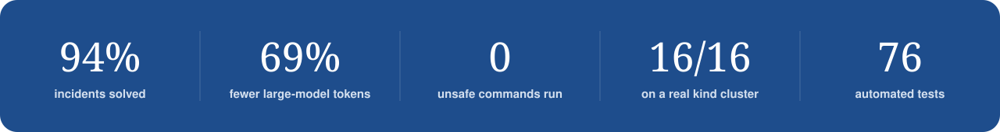
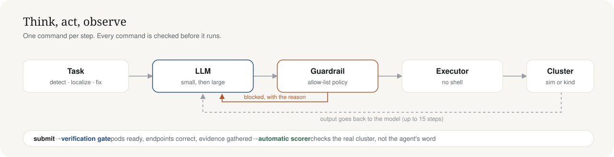
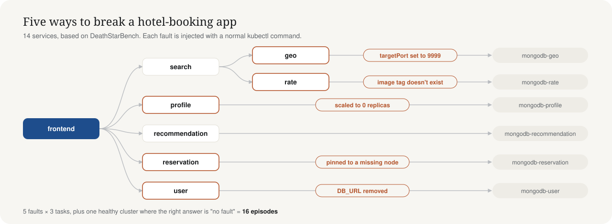
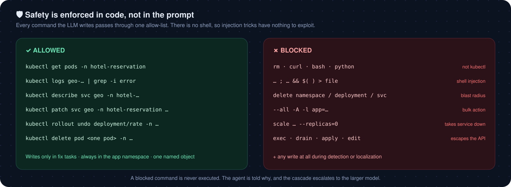

<div align="center">


<br/>

**OpsPilot** is an AI agent that handles the first response to a Kubernetes incident.<br/>
It finds what is broken, names the root cause and applies a minimal fix, and every command is checked before it runs.

<br/>


[](https://github.com/Kaushik-verse/kubernetes-ai-sre-agent/actions/workflows/ci.yml)


[Overview](#-overview) · [How it works](#-how-it-works) · [Scenarios](#-scenarios) · [Safety](#-safety) · [Results](#-results) · [Run it](#-run-it) · [FAQ](#-faq)

</div>

<br/>



## ✦ Overview

A modern website is many small services running on Kubernetes. When one breaks at 3 a.m., an on-call engineer has to find out *which* one and fix it, fast. OpsPilot does that first response:

| | Job | Question | Example answer |
|:-:|---|---|---|
| 1 | **Detection** | Is anything broken? | `Yes` |
| 2 | **Localization** | Which service is the root cause? | `["geo"]` |
| 3 | **Mitigation** | Fix it. | patches the Service; the cluster is healthy again |

These are the same three tasks Microsoft Research uses in [AIOpsLab](https://github.com/microsoft/AIOpsLab), and OpsPilot is scored the same way: inject a fault, let the agent work, check the result automatically.

## ✦ How it works



- **Cascade.** Every incident starts on the small `gpt-oss-20b`. The large `gpt-oss-120b` takes over only when the small model shows it is stuck: a format error, a blocked command, a repeated command, a "fixed" claim with no change, or 8 steps used. The idea follows FrugalGPT and RouteLLM, with no training needed.
- **Verification.** Before a fix is accepted, OpsPilot itself checks pods and endpoints. Before a diagnosis is accepted, it makes sure the agent actually looked at deployments, endpoints and logs.
- **Two backends.** A fast, deterministic Kubernetes simulator for experiments and CI, and a real [kind](https://kind.sigs.k8s.io/) cluster running the same scenarios.

<details>
<summary><b>One real step</b></summary>
<br/>

```text
model     Pods look Running, but I should check that services have endpoints.
          exec_shell("kubectl get endpoints -n hotel-reservation")
opspilot  guardrail: allowed (read) → run without a shell → output returned
model     geo has no endpoints on its container port. Describing the geo Service…
```
</details>

## ✦ Scenarios



| Scenario | What breaks | The fix to find |
|---|---|---|
| `scale_zero` | `profile` scaled to 0 replicas | scale it back up |
| `target_port` | `geo` Service points at port 9999 | patch the targetPort |
| `bad_image` | `rate` runs an image tag that doesn't exist | roll back |
| `node_selector` | `reservation` pinned to a missing node | remove the nodeSelector |
| `missing_env` | `user` loses its `DB_URL` | restore the variable |
| `healthy` | nothing | answer "no fault" |

## ✦ Safety



The model can suggest anything; only what passes the policy runs. Detection and localization are strictly read-only, and fixes are limited to one named object in the app namespace. A blocked command is never executed: the agent is told why, and the large model takes over.

## ✦ Results


<details>
<summary><b>Full table</b></summary>
<br/>

| Setup | Solved | Detect | Localize | Fix | Avg steps | Tokens / episode | Large-model share |
|---|:-:|:-:|:-:|:-:|:-:|:-:|:-:|
| **OpsPilot cascade** | **15/16** | 6/6 | 5/5 | 4/5 | 7.8 | 12.4k | **36%** |
| Cascade, no gates | 15/16 | 6/6 | 5/5 | 4/5 | 6.5 | 10.1k | 39% |
| Large model only | 16/16 | 6/6 | 5/5 | 5/5 | 7.6 | 14.6k | 100% |
| Small model only* | 15/16 | 6/6 | 5/5 | 4/5 | 7.9 | 12.5k | 0% |
| Scripted expert, real kind cluster | 16/16 | 6/6 | 5/5 | 5/5 | 3.6 | no LLM | no LLM |

\*Five episodes hit free-tier rate limits on the first pass and were re-run. Raw results and step-by-step traces are in [`results/`](results).
</details>

- **69% fewer large-model tokens** than a large-only agent, within 6 points of its accuracy.
- **No unsafe command ever ran**: everything outside the policy was blocked.
- **The test is real**: a scripted expert solves all 16 episodes on a real kind cluster.
- **Honest limits**: on this small set the small model alone also reaches 94%, and the gates don't change accuracy. Harder, multi-fault scenarios are the next step.

## ✦ Run it

Requires Python 3.11+, [uv](https://docs.astral.sh/uv/) and a free [Groq API key](https://console.groq.com/keys).

```bash
git clone https://github.com/Kaushik-verse/kubernetes-ai-sre-agent.git
cd kubernetes-ai-sre-agent && uv sync
cp .env.example .env            # add GROQ_API_KEY
make test                       # 76 tests, no key needed
make demo                       # watch the agent fix a broken Service
```

| Goal | Command |
|---|---|
| Check the scorer without an LLM | `make oracle` |
| Benchmark the agent | `uv run opspilot bench --configs cascade --run-id mine` |
| HTML report with traces | `uv run opspilot report mine` |
| Play on-call yourself | `uv run opspilot shell` |
| Real cluster | `make kind-up` → `make bench-kind` → `make kind-down` |
| Read-only check of any cluster | `uv run opspilot diagnose` |

<details>
<summary><b>Configuration</b></summary>
<br/>

| Variable | Default | Purpose |
|---|---|---|
| `GROQ_API_KEY` | (none) | Free Groq key |
| `OPSPILOT_PROVIDER` | `groq` | `groq`, `ollama` or `openai_compatible` |
| `OPSPILOT_SMALL_MODEL` | `openai/gpt-oss-20b` | First-line model |
| `OPSPILOT_LARGE_MODEL` | `openai/gpt-oss-120b` | Escalation model |
| `OPSPILOT_REASONING_EFFORT` | `low` | Keeps free-tier token use down |

Benchmark configs: `small`, `large`, `cascade`, `cascade-noverify`, `oracle`. Runs are resumable.
</details>

<details>
<summary><b>Project structure</b></summary>

```
src/opspilot/
├── agent.py            ReAct agent and context budget
├── router.py           small → large cascade
├── guardrails.py       command policy
├── actions.py          safe action parser (ast, never eval)
├── executor.py         shell-free runner
├── runner.py           episode loop, verification, scoring
├── llm.py              Groq / Ollama / OpenAI-compatible client
├── scenarios.py        fault definitions
├── sim/                Kubernetes simulator
├── live.py             kind backend
├── bench.py, report.py benchmark and HTML report
└── integrations/       AIOpsLab adapter
tests/                  76 tests
results/                benchmark runs and traces
```
</details>

GitHub Actions runs lint and tests, a kind end-to-end job, an optional agent benchmark and a Docker build on every push.

## ✦ FAQ

<details><summary><b>Why not let the model use bash?</b></summary><br/>For the same reason a new on-call engineer doesn't get root on day one. An allow-list fails closed, and without a shell there is nothing to inject into.</details>
<details><summary><b>Why a simulator?</b></summary><br/>It is deterministic, sub-second and runs in CI without Docker. The same scenarios also run on a real kind cluster.</details>
<details><summary><b>Does it work with the real AIOpsLab?</b></summary><br/>Yes. <code>integrations/aiopslab.py</code> implements its agent interface; the full suite needs a bigger machine than an 8 GB laptop.</details>
<details><summary><b>What's next?</b></summary><br/>Multi-fault scenarios, metrics and tracing tools, a learned router, and human approval for fixes.</details>

<div align="center">
<br/>

If this is useful or interesting, a ⭐ helps more people find it.

<sub>Built by <b>Ch Kaushik</b> · <a href="https://github.com/Kaushik-verse">@Kaushik-verse</a> · MIT License</sub>
</div>
